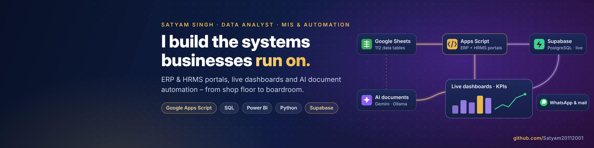
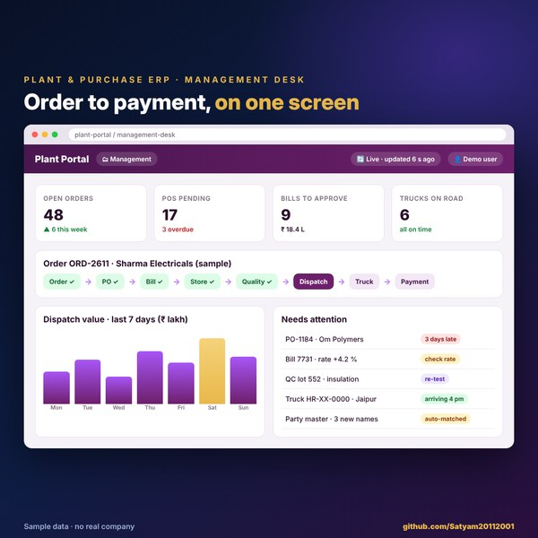
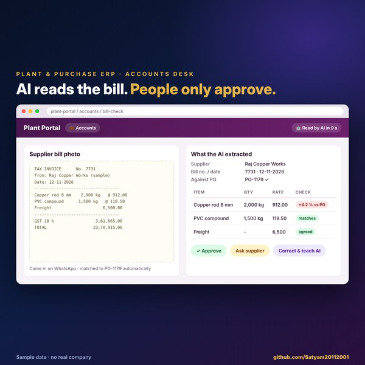
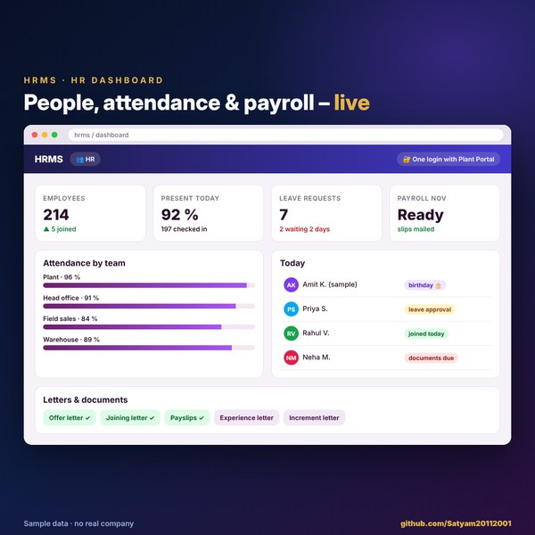
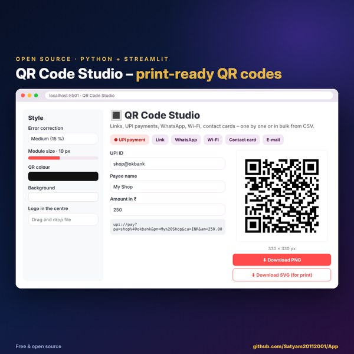

<h1 align="center">Hi, I'm Satyam Singh 👋</h1>

<b>Automation & MIS developer · Business systems on Google Workspace · Practical AI for operations</b>

  
  
  
  

I turn spreadsheets, mails and WhatsApp messages into working business software – for the plant, purchase, accounts, HR and sales teams of <b>KLJ Paraflex India Ltd.</b> (wires & cables).

---

### 🏭 What I build

- **Plant & purchase ERP portal** – orders to payment in one view: purchase orders, bills, store, quality, gate, dispatch and live truck tracking, connected to Busy accounting. Every desk works from one web portal, on phone or desktop.
- **HRMS & field-sales portal** – employees, attendance, payroll and letters, plus the sales team's working portal: calls, enquiries, targets, loyalty-scheme analytics and reports.
- **One system, two apps** – the same login for both, passwords synced safely, shared party master, and a PostgreSQL (Supabase) layer that takes the reading load off Google Sheets so many people can work at once, with screens that update by themselves.
- **AI that reads documents** – supplier bills, transport LRs and weighbridge slips read by AI (Gemini in the cloud, Ollama on an office laptop as a backup), checked against rates, and learning from every correction.
- **Automation everywhere** – WhatsApp and mail bridges, scheduled jobs, daily summaries, alerts when something is late, and housekeeping that keeps every Google file within its limits.

### 🖼️ A look at the work (sample data)

| Plant ERP – order to payment | AI reads supplier bills |
|---|---|
|  |  |
| **HRMS – people & payroll** | **QR Code Studio (open source)** |
|  |  |

### 💼 Experience

| Role | Company | Period |
|---|---|---|
| **Data Analyst – MIS & Business Automation** | KLJ Paraflex India Ltd., Delhi | Jan 2026 – present |
| **Operations Analyst** · Data Analytics Intern | Collegedunia, Gurugram | Mar 2025 – Jan 2026 |
| **System Administrator** | Energy Scape Renewables LLP, Noida | Oct 2023 – Mar 2025 |
| **IT Home Agent Specialist** | Teleperformance, Gurugram | Nov 2022 – Oct 2023 |
| **Network Help Desk Engineer** | Microsense Networks, Delhi | Apr 2021 – Nov 2022 |

### 🧰 Tools I use

### 📌 Open projects

| Project | What it is |
|---|---|
| [**Business Automation Roadmap**](https://github.com/users/Satyam20112001/projects/2) | Public board of what I have built (Done), what I am building now and what is next – ERP, HRMS, data layer, AI and analytics. |
| [**Plant ERP & HRMS showcase**](https://github.com/Satyam20112001/erp-hrms-showcase) | Screens and architecture of the two connected business apps I built – one login, AI bill reading, truck tracking, HR & sales portals (sample data). |
| [**QR Code Studio**](https://github.com/Satyam20112001/App) | Streamlit app for print-ready QR codes – links, UPI payments, WhatsApp, Wi-Fi, contact cards – one by one or in bulk from a CSV. |

*The ERP and HRMS code stays private; the showcase has screenshots with sample data.* · Need something similar? **[Hire me on Fiverr](https://www.fiverr.com/satyam_singh_20)**

### 📊 Analytics work

- **IPL Performance Analytics** (Power BI, Power Query) – 200,000+ ball-by-ball records, season / team / player drill-downs.
- **Automobile Sales Dashboard** (Power BI, DAX) – 50,000+ transactions; revenue, margin, growth and market share.
- **User Engagement & Revenue Dashboard** (Power BI) – DAU, WAU, MAU and retention for a gaming platform.
- **Zomato Market Trends** (Python, SQL, Tableau) · **Credit Card Fraud Detection** (PostgreSQL, PL/pgSQL) · **Customer Purchase Analysis** (Pandas, Seaborn).

### 🎓 Education & certifications

B.Com., University of Delhi (2021) · Data Analytics Professional – Ducat (2025) · Full Stack Data Analytics – Uncodemy (2024) · Diploma in Hardware & Networking (2022)

### 🤝 Get in touch

📧 [Satyam.singh152958@gmail.com](mailto:Satyam.singh152958@gmail.com) · 💼 [LinkedIn](https://www.linkedin.com/in/satyam-singh-508210213/)
